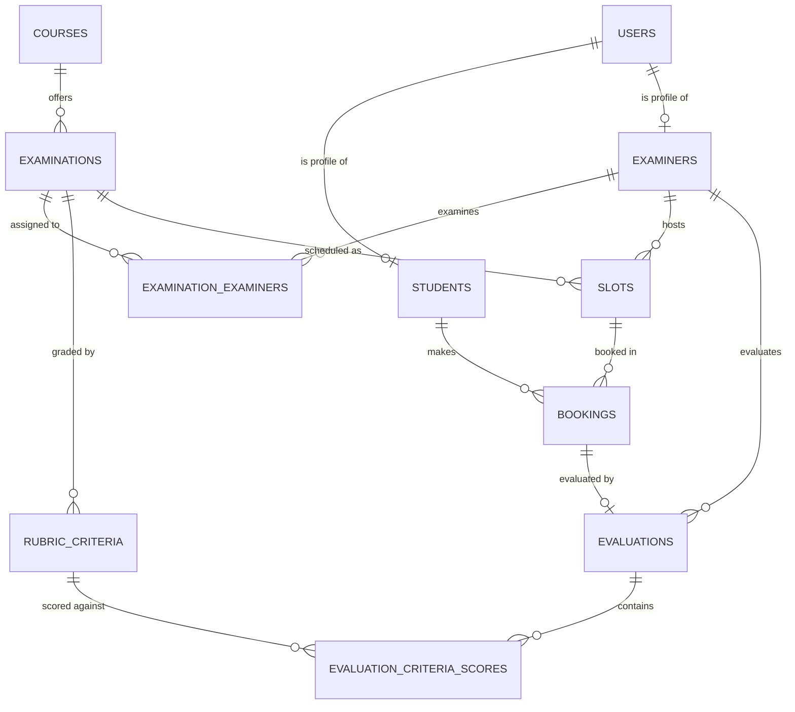
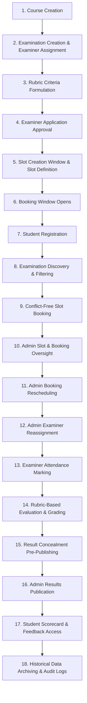

# IIT Madras — Modern Application Development 1 (MAD-1)
## Project Report: Examination Management Portal (EMP)

---

### Candidate & Project Identification
- **Project Title**: Examination Management Portal (EMP)
- **Course**: Modern Application Development 1 (MAD-1)
- **Academic Degree**: IIT Madras BS in Data Science and Applications
- **Student Full Name**: `[YOUR FULL NAME]`
- **Student Roll Number**: `[YOUR ROLL NUMBER / STUDENT ID]`
- **Student Email Address**: `[YOUR IITM STUDENT EMAIL]`
- **Date of Submission**: `[SUBMISSION DATE]`
- **Video Presentation / Demonstration Link**: `[YOUR UNLISTED YOUTUBE OR GOOGLE DRIVE VIDEO LINK]`

---

### Academic Integrity & AI / LLM Usage Declaration
> [!IMPORTANT]
> **IITM Academic Integrity Policy Requirement**:
> If any Generative AI or Large Language Model (LLM) tools were utilized during the development, debugging, or documentation of this project, you must explicitly declare their usage below prior to submission.
>
> **Declaration**:
> - **AI Tools Utilized**: `[e.g., Google Antigravity / Gemini CLI / GitHub Copilot / ChatGPT / None]`
> - **Nature of Assistance**: `[e.g., Assisted with scaffolding boilerplate, formulating unit test assertions, and structuring documentation]`
> - **Originality Confirmation**: `I hereby affirm that all application logic, database schemas, security controls, and implementations comply with IIT Madras Academic Honor Code, and I take full personal ownership and responsibility for every line of code submitted.`

---

## 1. Executive Summary & Problem Statement

### 1.1 Problem Statement
Higher educational institutions encounter complex logistics when organizing viva-voce examinations, practical assessments, and project demonstrations across multi-track academic programs. Traditional spreadsheet or manual coordination methods lead to critical failure modes:
1. **Double Booking & Time Collisions**: Students scheduling multiple assessments simultaneously, or examiners having overlapping slots.
2. **Capacity Overruns**: Uncontrolled student enrollments exceeding examiner evaluation bandwidth.
3. **Lack of Transparent Rubrics**: Subjective evaluation where criteria-level scoring breakdowns are not visible to students.
4. **Administrative Blindspots**: Inability to reschedule candidates, reassign examiners upon unforeseen absences, or audit scheduling history.

### 1.2 Proposed Solution: Examination Management Portal (EMP)
The Examination Management Portal (EMP) is a centralized, secure web application engineered to orchestrate the entire examination lifecycle. The system provides three tightly integrated, role-based workflows:
- **System Administrators**: Course governance, examination configuration, multi-criterion rubric creation, examiner approvals, slot and booking oversight, administrative rescheduling, examiner reassignment, and official results publishing.
- **Examiners**: Management of assigned examinations, time-bounded slot creation, candidate rosters, real-time attendance marking, criterion-by-criterion rubric grading, and evaluation history tracking.
- **Students**: Academic examination discovery with multi-attribute filtering, collision-free slot booking with immediate seat allocation, booking management/cancellation, and detailed scorecard transparency with criterion breakdowns.

---

## 2. Technology Stack & Architectural Constraints

The application strictly adheres to the IITM MAD-1 project specifications:

| Layer | Technology | Architectural Justification |
|---|---|---|
| **Backend Framework** | Python 3.11+ / Flask | Lightweight, modular WSGI web framework using Blueprints for strict separation of concerns. |
| **ORM & Database** | Flask-SQLAlchemy / SQLite 3 | Embedded, zero-configuration relational database with full ACID transaction compliance. |
| **Templating Engine** | Jinja2 | Secure server-side HTML rendering with auto-escaping to mitigate XSS vulnerabilities. |
| **Styling & UI** | Bootstrap 5.3 + Custom CSS | Mobile-responsive grid system and styling aligned with IITM academic themes. |
| **Security Layer** | Werkzeug Security | Industry-standard salted PBKDF2:SHA256 password hashing. |
| **Prohibited Stacks** | Strict Compliance | **Zero** React, Angular, Vue, Node.js, MongoDB, MySQL, or PostgreSQL. Zero core logic delegated to client-side JavaScript. |

---

## 3. System Architecture & Modular Design

The portal is architected using Flask Blueprints, ensuring high cohesion and low coupling across modules:

```text
. (Repository Root / examination_management_portal)
│
├── app.py                      # Flask Application Factory & Blueprints Registration
├── config.py                   # Centralized Configuration (Dev, Testing, Prod)
├── requirements.txt            # Core Dependencies
├── utils.py                    # Session Helpers & Role-Based Decorators (@role_required)
│
├── database/
│   ├── db.py                   # SQLAlchemy Instance
│   └── init_db.py              # Programmatic Schema DDL & Admin Account Seeding
│
├── models/                     # Relational Data Models
│   ├── user.py                 # User, Student, and Examiner Entities
│   ├── course.py               # Course Entity
│   ├── examination.py          # Examination, RubricCriterion, & Association Table
│   ├── slot.py                 # Examination Slot Entity
│   ├── booking.py              # Booking Entity with Audit & Reschedule Fields
│   └── evaluation.py           # Evaluation & EvaluationCriterionScore Entities
│
├── routes/                     # Blueprint Route Controllers
│   ├── auth.py                 # /auth/* (Login, Registration, Logout)
│   ├── admin.py                # /admin/* (Governance, Slots, Bookings, Reschedule, History)
│   ├── examiner.py             # /examiner/* (Slots, Attendance, Rubric Evaluations)
│   └── student.py              # /student/* (Catalog, Booking Engine, Scorecards, Profile)
│
├── templates/                  # Jinja2 Modular Templates
│   ├── base.html               # Master Layout (Navbar, Flash Alerts, Footer)
│   ├── auth/                   # Authentication Views
│   ├── admin/                  # Administrative Views
│   ├── examiner/               # Examiner Views
│   └── student/                # Student Views
│
└── tests/                      # Automated Verification Test Suites (76 Tests Total)
    ├── test_auth.py            # Authentication & RBAC Tests (11 tests)
    ├── test_admin.py           # Admin Governance Tests (7 tests)
    ├── test_examiner.py        # Examiner & Evaluation Tests (26 tests)
    ├── test_student.py         # Student & Booking Engine Tests (23 tests)
    └── test_integration.py    # 18-Step End-to-End Integration Tests (9 tests)
```

---

## 4. Database Schema & Entity Relationships

The schema is normalized to 3NF and enforces relational integrity through foreign key constraints, cascade rules, and indexes.



### 4.1 Detailed Table Specifications

1. **`users` Table**:
   - `id`: Primary Key (INTEGER).
   - `email`: VARCHAR(120), Unique, Indexed.
   - `password_hash`: VARCHAR(255), Werkzeug PBKDF2 salted hash.
   - `role`: VARCHAR(20), Restricted to `admin`, `examiner`, `student`.
   - `status`: VARCHAR(20), Restricted to `active`, `pending`, `deactivated`.
   - `created_at`: DATETIME UTC.

2. **`students` Table**:
   - `id`: Primary Key (INTEGER).
   - `user_id`: Foreign Key (`users.id`, ON DELETE CASCADE).
   - `roll_number`: VARCHAR(30), Unique, Indexed.
   - `full_name`: VARCHAR(100).
   - `program`: VARCHAR(100).
   - `department`: VARCHAR(100).
   - `contact_number`: VARCHAR(20).

3. **`examiners` Table**:
   - `id`: Primary Key (INTEGER).
   - `user_id`: Foreign Key (`users.id`, ON DELETE CASCADE).
   - `full_name`: VARCHAR(100).
   - `department`: VARCHAR(100).
   - `designation`: VARCHAR(100).
   - `contact_number`: VARCHAR(20).
   - `approval_status`: VARCHAR(20), Restricted to `pending`, `approved`, `deactivated`.

4. **`courses` Table**:
   - `id`: Primary Key (INTEGER).
   - `code`: VARCHAR(20), Unique, Indexed.
   - `name`: VARCHAR(150).
   - `description`: TEXT.
   - `credits`: INTEGER.
   - `department`: VARCHAR(100).
   - `status`: VARCHAR(20), `Active` or `Inactive`.
   - `created_at`: DATETIME UTC.

5. **`examinations` Table**:
   - `id`: Primary Key (INTEGER).
   - `course_id`: Foreign Key (`courses.id`, ON DELETE RESTRICT).
   - `name`: VARCHAR(150).
   - `exam_type`: VARCHAR(30), `Viva`, `Practical`, `Project Demo`, `Assessment`.
   - `duration`: INTEGER (minutes).
   - `max_marks`: FLOAT.
   - `slot_creation_start_date` / `slot_creation_end_date`: DATETIME.
   - `slot_booking_start_date` / `slot_booking_end_date`: DATETIME.
   - `status`: VARCHAR(30), `Draft`, `Slot Creation`, `Booking Open`, `Closed`, `Completed`.
   - `results_published`: BOOLEAN (Default: False).
   - `created_at`: DATETIME UTC.

6. **`examination_examiners` Table** *(Many-to-Many Association)*:
   - `examination_id`: Foreign Key (`examinations.id`, ON DELETE CASCADE).
   - `examiner_id`: Foreign Key (`examiners.id`, ON DELETE CASCADE).

7. **`rubric_criteria` Table**:
   - `id`: Primary Key (INTEGER).
   - `examination_id`: Foreign Key (`examinations.id`, ON DELETE CASCADE).
   - `criterion_name`: VARCHAR(150).
   - `max_marks`: FLOAT.
   - `weightage`: FLOAT (Default: 1.0).
   - `description`: TEXT.

8. **`slots` Table**:
   - `id`: Primary Key (INTEGER).
   - `examination_id`: Foreign Key (`examinations.id`, ON DELETE CASCADE).
   - `examiner_id`: Foreign Key (`examiners.id`, ON DELETE RESTRICT).
   - `date`: DATE.
   - `start_time` / `end_time`: TIME.
   - `capacity`: INTEGER.
   - `venue_or_link`: VARCHAR(255).
   - `status`: VARCHAR(20), `Available`, `Full`, `Cancelled`, `Completed`.
   - `created_at`: DATETIME UTC.

9. **`bookings` Table**:
   - `id`: Primary Key (INTEGER).
   - `student_id`: Foreign Key (`students.id`, ON DELETE CASCADE).
   - `slot_id`: Foreign Key (`slots.id`, ON DELETE RESTRICT).
   - `booking_time`: DATETIME UTC.
   - `status`: VARCHAR(20), `Booked`, `Cancelled`, `Completed`.
   - `attendance`: VARCHAR(20), `pending`, `present`, `absent`.
   - `score`: FLOAT (Aggregate marks).
   - `feedback`: TEXT.
   - `original_slot_id`: Foreign Key (`slots.id`, NULLABLE).
   - `rescheduled_at`: DATETIME UTC.
   - `rescheduled_by`: Foreign Key (`users.id`, NULLABLE).
   - `rescheduling_reason`: TEXT.
   - `history_notes`: TEXT.

10. **`evaluations` Table**:
    - `id`: Primary Key (INTEGER).
    - `booking_id`: Foreign Key (`bookings.id`, ON DELETE CASCADE, UNIQUE).
    - `examiner_id`: Foreign Key (`examiners.id`, ON DELETE RESTRICT).
    - `total_marks`: FLOAT.
    - `percentage`: FLOAT.
    - `general_feedback`: TEXT.
    - `evaluated_at`: DATETIME UTC.
    - `is_published`: BOOLEAN (Default: False).

11. **`evaluation_criteria_scores` Table**:
    - `id`: Primary Key (INTEGER).
    - `evaluation_id`: Foreign Key (`evaluations.id`, ON DELETE CASCADE).
    - `criterion_id`: Foreign Key (`rubric_criteria.id`, ON DELETE CASCADE).
    - `marks_obtained`: FLOAT.
    - `comments`: TEXT.

---

## 5. Core Business Logic & The 18-Step Examination Lifecycle

The portal supports the full 18-step end-to-end examination lifecycle verified by our integration test suite:



### Detailed Lifecycle Engine Rules

1. **Course Creation**: Admin creates course (`code`, `name`, `credits`, `department`). Course code uniqueness is strictly enforced.
2. **Examination Creation**: Linked to course. Configured with type, duration, maximum marks, and scheduling date windows.
3. **Rubric Criteria Formulation**: Dynamic criteria configured by Admin. The system enforces that $\sum \text{Criterion Max Marks} \le \text{Examination Max Marks}$. Rubrics are locked from modification once evaluations commence.
4. **Examiner Application Approval**: Examiners register into a `pending` queue; admin verification changes status to `approved`, granting dashboard access.
5. **Slot Creation Window**: Examiners define slots only within the examination's slot creation date window. Slots require `start_time < end_time` and non-overlapping schedules for that examiner.
6. **Booking Window Transition**: Admin or automated timeline updates advance the examination status to `Booking Open`.
7. **Student Registration**: Students register with unique email and academic roll number.
8. **Catalog Discovery**: Students browse active examinations, filter by course code, search by name, and inspect live slot seat counts.
9. **Collision-Free Booking Engine**:
   - *Single Booking Constraint*: A student cannot hold multiple active bookings for the same examination.
   - *Time Collision Guard*: A student cannot book a slot that overlaps in date and time with any other active booking.
   - *Capacity Enforcement*: Booking decrements available seats. If `available_seats == 0`, the slot status automatically shifts to `Full`.
   - *Deadline Guard*: Bookings outside the examination booking window or in the past are rejected.
10. **Admin Slot & Booking Oversight**: Global views (`/admin/slots` and `/admin/bookings`) provide multi-attribute filtering across all entities.
11. **Admin Booking Rescheduling**: Admin can reschedule any student booking to an alternative available slot. The engine decrements new slot capacity, increments old slot capacity, and appends an immutable audit entry to `history_notes`.
12. **Admin Examiner Reassignment**: In the event of examiner illness or absence, Admin can reassign slot ownership to any approved examiner linked to the examination.
13. **Examiner Attendance Marking**: Examiner marks student attendance (`present` or `absent`). Absent candidates cannot receive scores.
14. **Rubric-Based Evaluation**: Examiner enters marks per rubric criterion, ensuring $0 \le \text{Mark} \le \text{Criterion Max Marks}$. Total score and percentage are calculated server-side.
15. **Result Concealment**: Evaluations remain concealed from students until official publication to prevent preliminary score leaks.
16. **Admin Results Publication**: Admin triggers official publication (`/admin/examinations/<id>/publish-results`), toggling `is_published = True`.
17. **Student Scorecard Transparency**: Students access detailed scorecards displaying overall percentage, criterion-by-criterion marks, and examiner commentary.
18. **Historical Archival**: Completed examinations, past slots, and historical bookings remain permanently accessible in the Admin Historical Data archive (`/admin/history`).

---

## 6. Security, Authentication & Data Integrity

1. **Cryptographic Password Storage**: Werkzeug salted PBKDF2:SHA256 password hashing ensures credentials cannot be recovered even if the database file is compromised.
2. **Role-Based Access Control (RBAC)**: Custom decorators `@login_required` and `@role_required(['admin', 'examiner', 'student'])` enforce strict endpoint isolation:
   - Students accessing `/admin/*` or `/examiner/*` receive HTTP 403 Forbidden.
   - Unauthenticated requests are redirected to `/auth/login` with appropriate flash warnings.
   - Pending or deactivated examiners are prevented from accessing evaluation endpoints.
3. **SQL Injection Immunity**: 100% of database queries utilize SQLAlchemy ORM parameterized query builders. Direct SQL string concatenation is completely absent.
4. **Data Tampering Protection**: Protected student fields (User ID, Role, Roll Number, Email) cannot be modified via HTTP POST parameter injection.
5. **Timezone Normalization (Naive/Aware Bridging)**: SQLite natively stores datetime strings without timezone offsets. The application normalizes comparisons with `_to_utc()` helpers, completely avoiding Python `TypeError` offset-naive and offset-aware exceptions.

---

## 7. Comprehensive API & Route Specification

The application implements **57 modular routes**:

### 7.1 Authentication Blueprint (`routes/auth.py`)
| Route | Method | Access | Purpose |
|---|---|---|---|
| `/auth/login` | `GET`, `POST` | Public | Authenticates credentials and redirects to role dashboard |
| `/auth/register/student` | `GET`, `POST` | Public | Student registration with roll number uniqueness check |
| `/auth/register/examiner` | `GET`, `POST` | Public | Examiner registration (enters `pending` status) |
| `/auth/pending-approval` | `GET` | Examiner | Displays pending status notice for unapproved examiners |
| `/auth/logout` | `GET` | Authenticated | Clears session dictionary and redirects to landing page |

### 7.2 Administrator Blueprint (`routes/admin.py`)
| Route | Method | Access | Purpose |
|---|---|---|---|
| `/admin/dashboard` | `GET` | Admin | Real-time aggregate metrics & quick navigation |
| `/admin/courses` | `GET` | Admin | Course catalog with search and status filters |
| `/admin/courses/create` | `GET`, `POST` | Admin | Creates a new academic course |
| `/admin/courses/<id>/edit` | `GET`, `POST` | Admin | Updates course metadata |
| `/admin/courses/<id>/delete` | `POST` | Admin | Deletes course (guarded if exams exist) |
| `/admin/courses/<id>/toggle-status` | `POST` | Admin | Toggles course between Active and Inactive |
| `/admin/examinations` | `GET` | Admin | Examination catalog with search and filters |
| `/admin/examinations/create` | `GET`, `POST` | Admin | Creates examination and assigns examiners |
| `/admin/examinations/<id>` | `GET` | Admin | Control center: rubrics, slots, timeline controls |
| `/admin/examinations/<id>/edit` | `GET`, `POST` | Admin | Edits examination parameters |
| `/admin/examinations/<id>/delete` | `POST` | Admin | Deletes examination (guarded if bookings exist) |
| `/admin/examinations/<id>/status/<st>` | `POST` | Admin | Transitions examination state (Slot Creation, Booking Open, etc.) |
| `/admin/examinations/<id>/rubrics/add` | `POST` | Admin | Adds rubric criterion (enforces mark ceiling) |
| `/admin/examinations/<id>/rubrics/<rid>/edit` | `POST` | Admin | Updates rubric criterion |
| `/admin/examinations/<id>/rubrics/<rid>/delete` | `POST` | Admin | Deletes rubric criterion |
| `/admin/examinations/<id>/publish-results` | `POST` | Admin | Publishes evaluation scorecards to students |
| `/admin/examiners` | `GET` | Admin | Examiner registry with status filter |
| `/admin/examiners/<id>` | `GET` | Admin | Detailed examiner profile and assigned exams |
| `/admin/examiners/<id>/approve` | `POST` | Admin | Approves pending examiner account |
| `/admin/examiners/<id>/deactivate` | `POST` | Admin | Deactivates examiner account |
| `/admin/examiners/<id>/reactivate` | `POST` | Admin | Reactivates deactivated examiner |
| `/admin/students` | `GET` | Admin | Student registry with search & program filter |
| `/admin/students/<id>` | `GET` | Admin | Student academic profile and booking history |
| `/admin/slots` | `GET` | Admin | Global examination slot overview with multi-filters |
| `/admin/slots/<id>/reassign-examiner` | `POST` | Admin | Reassigns slot examiner with booking updates |
| `/admin/bookings` | `GET` | Admin | Global student booking management |
| `/admin/bookings/<id>` | `GET` | Admin | Booking detail and audit trail viewer |
| `/admin/bookings/<id>/reschedule` | `GET`, `POST` | Admin | Reschedules booking to alternative available slot |
| `/admin/history` | `GET` | Admin | Tabbed historical archive (exams, slots, bookings, evaluations) |

### 7.3 Examiner Blueprint (`routes/examiner.py`)
| Route | Method | Access | Purpose |
|---|---|---|---|
| `/examiner/dashboard` | `GET` | Examiner | Live stats (assigned exams, slots, candidates, pending evaluations) |
| `/examiner/examinations` | `GET` | Examiner | Assigned examinations list |
| `/examiner/examinations/<id>` | `GET` | Examiner | Examination view with rubric details and slot tools |
| `/examiner/examinations/<id>/slots/create` | `GET`, `POST` | Examiner | Creates new slot within allowed time window |
| `/examiner/slots/<id>/edit` | `GET`, `POST` | Examiner | Edits slot (guarded if candidates have booked) |
| `/examiner/slots/<id>/cancel` | `POST` | Examiner | Cancels slot |
| `/examiner/students` | `GET` | Examiner | Consolidated candidate booking roster |
| `/examiner/slots/<id>/students` | `GET` | Examiner | Slot-specific candidate roster |
| `/examiner/bookings/<id>/attendance` | `POST` | Examiner | Marks candidate attendance (`present`/`absent`) |
| `/examiner/evaluate/<booking_id>` | `GET`, `POST` | Examiner | Multi-criterion rubric evaluation and grading |
| `/examiner/evaluations` | `GET` | Examiner | Completed evaluations history |

### 7.4 Student Blueprint (`routes/student.py`)
| Route | Method | Access | Purpose |
|---|---|---|---|
| `/student/dashboard` | `GET` | Student | Summary stats (available exams, bookings, results) |
| `/student/examinations` | `GET` | Student | Browse exams with search, course & type filters |
| `/student/examinations/<id>` | `GET` | Student | Examination detail and live slot selection |
| `/student/slots/<id>/book` | `POST` | Student | Books examination slot with full validation |
| `/student/bookings` | `GET` | Student | List of student bookings |
| `/student/bookings/<id>` | `GET` | Student | Booking confirmation receipt |
| `/student/bookings/<id>/cancel` | `POST` | Student | Cancels booking and restores slot seat |
| `/student/results` | `GET` | Student | View published scorecards |
| `/student/results/<id>` | `GET` | Student | Detailed criterion-by-criterion scorecard |
| `/student/history` | `GET` | Student | Academic examination participation record |
| `/student/profile` | `GET`, `POST` | Student | View profile and update contact details |

---

## 8. Verification & Test Execution Results

The application includes **76 comprehensive automated test cases** covering every functional requirement, edge case, and security boundary:

```bash
python3 -m unittest discover tests -v
```

### 8.1 Test Execution Summary

| Test Suite | File | Tests | Key Validations | Result |
|---|---|---|---|---|
| **Authentication & RBAC** | `test_auth.py` | 11 | Seeded admin login, password validation, duplicate email prevention, role guards, pending examiner gating | **PASSED** |
| **Admin Operations** | `test_admin.py` | 7 | Real statistics calculation, course CRUD, deletion guards, exam timeline controls, rubric ceilings | **PASSED** |
| **Examiner Workflows** | `test_examiner.py` | 26 | Slot creation within window, capacity validation, candidate rosters, attendance marking, rubric grading | **PASSED** |
| **Student & Booking Engine** | `test_student.py` | 23 | Exam browsing/filters, time collision prevention, duplicate booking rejection, seat exhaustion, cancellations | **PASSED** |
| **End-to-End Integration** | `test_integration.py` | 9 | Complete 18-step lifecycle, global slot overview, search, rescheduling audit, examiner reassignment, history | **PASSED** |
| **Total Automated Coverage** | — | **76** | **All 5 Project Batches Verified End-to-End** | **100% OK** |

---

## 9. Limitations & Future Roadmap

### 9.1 Current Architectural Limitations
1. **Concurrency Control in SQLite**: SQLite operates with table-level locking for write transactions. Under high concurrent write spikes (hundreds of simultaneous booking attempts per second), write locks may cause transient latency.
2. **Notification Simulation**: Student booking confirmations and evaluation alerts are delivered via flash messages and application receipts; direct email/SMS dispatch is simulated.
3. **External Calendar Sync**: Calendar reminders currently rely on in-portal datetime displays rather than direct iCal/Google Calendar webhook synchronizations.

### 9.2 Future Roadmap & Enhancements
- **Task Queue & Async Workers**: Integrating Celery with Redis for asynchronous background tasks such as automated email dispatch and report generation.
- **WebSocket Push Notifications**: Implementing Flask-SocketIO for real-time live seat decrementing on student slot browsing pages without requiring manual page refresh.
- **Automated Scorecard PDF Export**: Incorporating ReportLab or Weasyprint to allow students and administrators to download signed academic PDF scorecards.
- **Multi-Factor Authentication (MFA)**: Adding TOTP-based 2FA for examiner and administrative accounts.

---

## 10. Local Deployment & Setup Guide

### Step 1: Environment Setup
```bash
# Clone and enter the project repository
cd examination_management_portal

# Create and activate a Python virtual environment
python3 -m venv venv
source venv/bin/activate
```

### Step 2: Install Dependencies
```bash
pip install -r requirements.txt
```

### Step 3: Initialize Database Programmatically
```bash
python3 database/init_db.py
```
*Creates `instance/emp.sqlite` and seeds the default administrator account.*

### Step 4: Run the Web Server
```bash
python3 app.py
```
*Server launches at `http://127.0.0.1:5000/`.*

### Step 5: Default Administrator Credentials
- **Login URL**: `http://127.0.0.1:5000/auth/login`
- **Email**: `admin@emp.iitm.ac.in`
- **Password**: `AdminPassword123!`

### Step 6: Execute Automated Test Suite
```bash
python3 -m unittest discover tests -v
```
*(Executes all 76 unit and integration test cases).*
