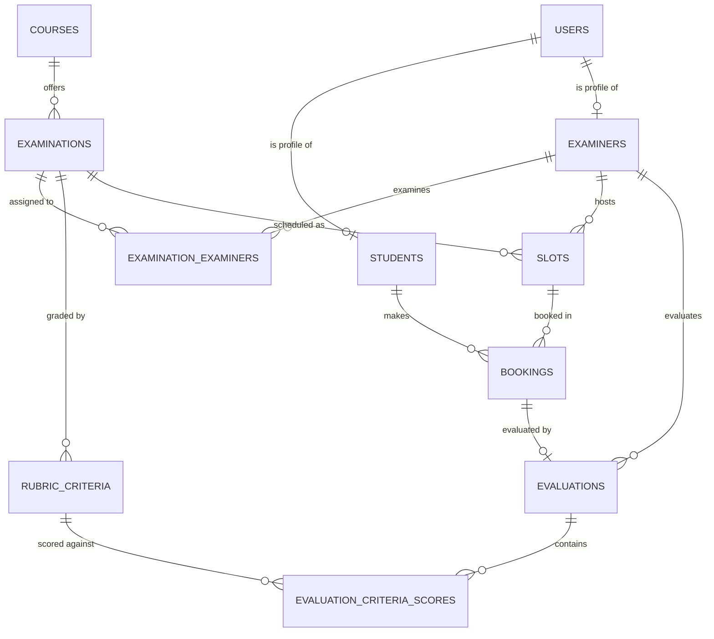

# Examination Management Portal (EMP)

An enterprise-grade, role-based academic portal engineered for the **IIT Madras Modern Application Development 1 (MAD-1)** project. The Examination Management Portal (EMP) coordinates oral examinations, viva-voce assessments, practical evaluations, and project demonstrations across academic programs.

> 📁 **Demo Video Folder**: [Demo Video Folder](https://drive.google.com/file/d/1KCQ8O46NbcouLB5uCalOvUGKzvFOgWRU/view?usp=drive_link)

---

## Table of Contents
1. [Project Overview & Objectives](#1-project-overview--objectives)
2. [Problem Statement](#2-problem-statement)
3. [User Roles & Architectural Workflows](#3-user-roles--architectural-workflows)
4. [Comprehensive Feature List](#4-comprehensive-feature-list)
5. [Technology Stack & Architectural Compliance](#5-technology-stack--architectural-compliance)
6. [Project Directory Structure](#6-project-directory-structure)
7. [Prerequisites](#7-prerequisites)
8. [Step-by-Step Installation & Setup](#8-step-by-step-installation--setup)
9. [Database Initialization & Programmatic Seeding](#9-database-initialization--programmatic-seeding)
10. [Running the Application Locally](#10-running-the-application-locally)
11. [Default Administrator Development Credentials](#11-default-administrator-development-credentials)
12. [Database Schema & Entity Relationships](#12-database-schema--entity-relationships)
13. [Testing Instructions & Commands](#13-testing-instructions--commands)
14. [Troubleshooting Common Issues](#14-troubleshooting-common-issues)
15. [Academic Integrity & AI / LLM Usage Disclosure](#15-academic-integrity--ai--llm-usage-disclosure)
16. [Known Limitations & Future Roadmap](#16-known-limitations--future-roadmap)
17. [Known Issues and Testing Notes](#17-known-issues-and-testing-notes)
18. [License & Academic Attribution](#18-license--academic-attribution)

---

## 1. Project Overview & Objectives

The **Examination Management Portal (EMP)** is a centralized web platform designed to streamline and automate academic oral examinations, viva-voce sessions, project demos, and laboratory assessments.

### Key Objectives
- **End-to-End Governance**: Coordinate administrators, examiners, and students under a unified, role-based platform.
- **Collision-Free Scheduling**: Guarantee zero overlapping slots for candidates and eliminate double-booking across academic examinations.
- **Capacity Management**: Enforce slot capacity constraints with automatic seat decrementing and state transitions.
- **Rubric-Based Evaluation**: Support objective, criterion-level grading with maximum mark limits and examiner commentary.
- **Administrative Flexibility**: Provide tools for rescheduling bookings, reassigning examiners during unexpected absences, and archiving historical data.
- **Student Transparency**: Provide immediate booking confirmation receipts and detailed scorecards breakdown upon official publication.

---

## 2. Problem Statement

Academic institutions often face significant logistical friction when managing practical and viva-voce examinations:
1. **Spreadsheet Chaos**: Manual coordination via shared sheets results in race conditions, double-booked candidates, and conflicting examiner assignments.
2. **Capacity Overruns**: Without automated guardrails, individual slots exceed evaluator capacity, compromising assessment quality.
3. **Opaque Scoring**: Students frequently receive aggregated grades without transparency into criterion-level rubric performance or constructive examiner feedback.
4. **Rescheduling Deadlocks**: When examiners or students experience emergency conflicts, manual rescheduling is time-consuming and prone to lost audit trails.
5. **Security & Integrity Risks**: Uncontrolled cross-access allows unapproved evaluators or unauthorized students to tamper with examination schedules and marks.

The EMP solves these challenges through a modular Flask backend, ACID-compliant SQLite transactions, role-based access control (RBAC), and server-side validation.

---

## 3. User Roles & Architectural Workflows

The portal supports three distinct user roles:

```mermaid
flowchart TD
    subgraph AdminRole [Administrator]
        A1[Manage Courses] --> A2[Create Examinations]
        A2 --> A3[Define Rubric Criteria]
        A3 --> A4[Approve Examiners]
        A4 --> A5[Open Booking Windows]
        A5 --> A6[Reschedule Bookings / Reassign Examiners]
        A6 --> A7[Publish Official Results]
    end

    subgraph ExaminerRole [Examiner]
        E1[Register Account] --> E2[Await Admin Approval]
        E2 --> E3[View Assigned Exams]
        E3 --> E4[Create Time Slots]
        E4 --> E5[Mark Student Attendance]
        E5 --> E6[Grade via Rubrics & Submit Feedback]
    end

    subgraph StudentRole [Student]
        S1[Register with Roll Number] --> S2[Browse Open Exams]
        S2 --> S3[Book Available Slot]
        S3 --> S4[Receive Confirmation Receipt]
        S4 --> S5[Attend Examination]
        S5 --> S6[View Published Scorecard Breakdown]
    end
```



### 18-Step Examination Lifecycle
1. **Course Creation**: Administrator defines course code, title, department, and credit value.
2. **Examination Configuration**: Administrator links examination to course, defines type, duration, maximum marks, and scheduling windows.
3. **Rubric Definition**: Administrator creates scoring criteria ensuring total rubric marks equal or do not exceed the examination ceiling.
4. **Examiner Application & Approval**: Faculty register into a pending queue; Administrator inspects credentials and approves the account.
5. **Examiner Assignment**: Administrator links approved examiners to the examination.
6. **Slot Definition Window**: Assigned examiners create slots within the designated slot creation period.
7. **Booking Window Opens**: Examination transitions to `Booking Open`.
8. **Student Registration**: Students register with unique email and academic roll number.
9. **Catalog Discovery**: Students browse available assessments and filter by course code and examination type.
10. **Conflict-Free Slot Booking**: Student books an available slot with capacity validation and time overlap checks.
11. **Seat Decrementing**: Slot available capacity decreases; when capacity reaches zero, the slot automatically transitions to `Full`.
12. **Administrative Oversight**: Administrator monitors active bookings and slots across all courses.
13. **Rescheduling / Reassignment**: If needed, Administrator reschedules candidate bookings or reassigns slot ownership to another examiner with an immutable audit log.
14. **Attendance Marking**: Examiner marks candidate as `present` or `absent`.
15. **Rubric Grading**: Examiner inputs scores per rubric criterion and provides qualitative commentary.
16. **Score Concealment**: Evaluations remain concealed until officially authorized for release.
17. **Results Publication**: Administrator officially publishes results.
18. **Student Scorecard & Archival**: Students view criterion breakdown; examination data moves to the historical archive.

---

## 4. Comprehensive Feature List

### 4.1 Administrator Module (`/admin/*`)
- **Analytics Dashboard**: Real-time aggregate counters for Courses, Examinations, Approved Examiners, Registered Students, Examination Slots, and Bookings.
- **Course Management**:
  - Full CRUD functionality (Create, Read, Update, Delete).
  - Unique course code constraint validation.
  - Active/Inactive status toggle.
  - Deletion guard preventing removal if linked examinations exist.
- **Examination Management**:
  - Full CRUD functionality with course linkage, duration, maximum marks, and exam types (`Viva`, `Practical`, `Project Demo`, `Assessment`).
  - Scheduling window configuration: Slot Creation Window and Slot Booking Window.
  - Status progression engine: `Draft` → `Slot Creation` → `Booking Open` → `Closed` → `Completed`.
  - Guarded deletion preventing removal if candidate bookings exist.
- **Rubric Criteria Builder**:
  - Add, edit, and delete criteria per examination.
  - Ceiling validation: prevents criterion totals from exceeding maximum exam marks.
  - Evaluation locking: rubrics cannot be modified after candidate evaluations are submitted.
- **Examiner Governance**:
  - Application queue with status filtering (`all`, `pending`, `approved`, `deactivated`).
  - One-click approval, deactivation, and reactivation.
  - Detailed examiner profile and assigned examination history.
- **Student Directory**:
  - Searchable student catalog with roll number and program filters.
  - Individual academic profiles with booking records and evaluation statuses.
- **Examination Slots Overview (`/admin/slots`)**:
  - Comprehensive slot directory displaying examination, course, examiner, date, timings, capacity, booked candidates, and status.
  - Multi-attribute search and filtering (course, exam, examiner, date, slot status).
  - **Examiner Reassignment Modal**: Reassign any slot to another approved examiner assigned to that examination, updating all booking linkages automatically.
- **Booking Management (`/admin/bookings`)**:
  - Global overview of all student bookings.
  - Search by Student Name, Roll Number, Examination Name, or Booking ID.
  - Multi-attribute filters for course, exam, and booking status.
  - Detailed booking view (`/admin/bookings/<id>`) with complete candidate and slot details.
- **Administrative Rescheduling Engine (`/admin/bookings/<id>/reschedule`)**:
  - View alternative available slots for the same examination.
  - Real-time seat capacity checks and status management.
  - Restores original slot capacity, decrements destination slot capacity, and records historical audit notes (`original_slot_id`, `rescheduled_at`, `rescheduled_by`, `rescheduling_reason`, `history_notes`).
- **Results Publishing (`/admin/examinations/<id>/publish-results`)**:
  - One-click official publication releasing scorecards to students.
- **Historical Data Archive (`/admin/history`)**:
  - Tabbed interface displaying Archived Examinations, Past & Cancelled Slots, Historical Bookings, and Evaluation Records.

### 4.2 Examiner Module (`/examiner/*`)
- **Access Guard**: Only approved examiners can access the portal; pending examiners are redirected to an informative pending page.
- **Examiner Dashboard**: Live statistics for Assigned Examinations, Created Slots, Booked Candidates, Pending Evaluations, and Completed Evaluations.
- **Assigned Examinations (`/examiner/examinations`)**: View examinations assigned by Admin with duration, maximum marks, and scheduling windows. Unauthorized examinations are inaccessible.
- **Slot Management (`/examiner/slots`)**:
  - Create slots within the designated slot creation date window.
  - Validation: start time before end time, non-overlapping examiner schedules, positive capacity.
  - Slot editing and cancellation restricted to slots with zero bookings or prior to booking window opening.
- **Candidate Roster & Attendance (`/examiner/students`)**:
  - Consolidated candidate roster across all slots.
  - Slot-specific candidate view with one-click attendance marking (`present`, `absent`, `pending`).
- **Multi-Criterion Rubric Evaluation (`/examiner/evaluate/<booking_id>`)**:
  - Criterion-by-criterion marks entry with real-time rubric max marks constraints.
  - General remarks and specific criterion feedback.
  - Automatic calculation of total marks and percentage.
  - Re-grading and update support prior to official results publication.
- **Evaluation History (`/examiner/evaluations`)**: Archive of all submitted evaluations with student details, marks awarded, and status badges.

### 4.3 Student Module (`/student/*`)
- **Student Dashboard**: Real-time counters for Available Examinations, Available Slots, Upcoming Examinations, My Booked Slots, and Published Results.
- **Examination Browsing (`/student/examinations`)**:
  - Search by exam name; filter by course and exam type.
  - Displays booking deadlines, durations, maximum marks, and available slots count.
  - Only examinations with `Booking Open` status can be booked.
- **Real-Time Slot Selection & Booking (`/student/examinations/<id>`)**:
  - View dates, start/end times, venue/meeting links, and remaining seats.
  - One-click booking with instant confirmation receipt (`/student/bookings/<id>`).
- **Strict Booking Validation Engine**:
  - Prevents booking outside the slot booking date window.
  - Prevents duplicate bookings for the same examination.
  - Prevents booking conflicting or overlapping slots across different examinations.
  - Prevents booking full slots (automatically transitions slot to `Full` when capacity is exhausted).
  - Prevents booking past slots.
- **Booking Cancellation & Seat Restoration (`/student/bookings/<id>/cancel`)**:
  - Allows cancellation of upcoming bookings prior to slot start time.
  - Restores slot capacity and transitions slot status from `Full` back to `Available`.
  - Permits student to re-book an alternative slot or the same slot after cancellation.
- **Scorecard & Results View (`/student/results`)**:
  - Shows overall percentage, total score, and evaluation status.
  - Detailed scorecard view (`/student/results/<id>`) showing criterion-by-criterion marks obtained vs maximum marks, along with examiner feedback.
  - Unreleased/unpublished results are strictly hidden from students.
- **Profile Management (`/student/profile`)**:
  - View roll number, email, and program.
  - Update allowed contact details (phone, department) with tamper-proof protection against modifying roll number, user ID, or role.

---

## 5. Technology Stack & Architectural Compliance

| Component | Technology | Version | Purpose |
|---|---|---|---|
| **Language** | Python | 3.10 / 3.11 / 3.12 | Core programming language |
| **Backend Framework** | Flask | >= 3.0.0 | WSGI web application framework & Blueprints |
| **ORM** | Flask-SQLAlchemy | >= 3.1.0 | Object-Relational Mapping & ACID SQLite management |
| **Security** | Werkzeug | >= 3.0.0 | PBKDF2:SHA256 salted password hashing & session security |
| **Templating** | Jinja2 | >= 3.1.0 | Server-side templating with automatic XSS escaping |
| **Database** | SQLite 3 | Embedded | Relational database (zero-configuration, embedded) |
| **Frontend Styling** | Bootstrap | 5.3.0 (CDN) | Responsive grid layout, modals, badges, navigation |
| **Custom Styling** | CSS3 | Native | Custom theme styling in `static/css/style.css` |

### Architectural Compliance
- **Zero Forbidden Frameworks**: Strictly no React, Angular, Vue, Node.js, MongoDB, MySQL, or PostgreSQL.
- **JavaScript Policy**: No core application logic is handled by JavaScript; all authentication, booking validations, filtering, evaluations, and administrative controls operate strictly server-side.
- **Modular Blueprints**: Separation into `auth`, `admin`, `examiner`, and `student` blueprints.

---

## 6. Complete Project Directory Structure

```text
. (Repository Root / examination_management_portal)
│
├── app.py                              # Flask application entrypoint & factory
├── config.py                           # Configuration classes (Dev, Testing, Prod)
├── requirements.txt                    # Project dependencies
├── utils.py                            # Session helpers & role-based access decorators
├── README.md                           # Technical documentation & run instructions
├── PROJECT_REPORT.md                   # IITM MAD-1 project report with required placeholders
├── .gitignore                          # Git ignore specification
│
├── database/
│   ├── db.py                           # SQLAlchemy db instance
│   └── init_db.py                      # Programmatic database initialization & admin seeding
│
├── models/
│   ├── __init__.py                     # Model package aggregator
│   ├── user.py                         # User, Student, and Examiner profile entities
│   ├── course.py                       # Course entity (code, name, status, department, credits)
│   ├── examination.py                  # Examination, RubricCriterion, & examination_examiners table
│   ├── slot.py                         # Examination Slot entity with capacity & time tracking
│   ├── booking.py                      # Student Booking entity with rescheduling audit fields
│   └── evaluation.py                   # Evaluation & EvaluationCriterionScore entities
│
├── routes/
│   ├── auth.py                         # Authentication blueprint (/auth/*)
│   ├── admin.py                        # Administrator blueprint (/admin/*)
│   ├── examiner.py                     # Examiner blueprint (/examiner/*)
│   └── student.py                      # Student blueprint (/student/*)
│
├── templates/
│   ├── base.html                       # Global layout with role-based navbar, alerts & footer
│   ├── index.html                      # Portal landing page
│   ├── 403.html                        # HTTP 403 Forbidden error page
│   ├── 404.html                        # HTTP 404 Not Found error page
│   ├── 500.html                        # HTTP 500 Internal Server Error page
│   │
│   ├── auth/
│   │   ├── login.html                  # Unified login portal for all roles
│   │   ├── register_student.html       # Student self-registration form
│   │   ├── register_examiner.html      # Examiner registration (pending state)
│   │   └── pending_approval.html       # Pending approval notice for unverified examiners
│   │
│   ├── admin/
│   │   ├── sidebar.html                # Admin navigation sidebar partial
│   │   ├── dashboard.html              # Central statistics & analytics overview
│   │   ├── courses/
│   │   │   ├── index.html              # Course registry, search, status filters
│   │   │   └── form.html               # Course creation & editing modal/form
│   │   ├── examinations/
│   │   │   ├── index.html              # Examination listings, search & status filters
│   │   │   ├── form.html               # Examination creation & scheduling form
│   │   │   └── view.html               # Examination control center: rubrics, slots, timeline
│   │   ├── examiners/
│   │   │   ├── index.html              # Examiner queue, approval actions, search & filters
│   │   │   └── view.html               # Examiner profile & assigned examinations
│   │   ├── students/
│   │   │   ├── index.html              # Student registry with search & program filter
│   │   │   └── view.html               # Student academic profile & booking history
│   │   ├── slots/
│   │   │   └── index.html              # All examination slots overview & examiner reassignment
│   │   ├── bookings/
│   │   │   ├── index.html              # All student bookings overview & multi-attribute search
│   │   │   ├── view.html               # Detailed booking receipt & audit trail viewer
│   │   │   └── reschedule.html         # Admin booking rescheduling modal/interface
│   │   └── history/
│   │       └── index.html              # Tabbed historical archive (exams, slots, bookings, evaluations)
│   │
│   ├── examiner/
│   │   ├── sidebar.html                # Examiner navigation sidebar partial
│   │   ├── dashboard.html              # Real-time metrics: assigned exams, slots, candidates, pending
│   │   ├── examinations/
│   │   │   ├── index.html              # Assigned examinations catalog
│   │   │   └── view.html               # Examination details, rubric criteria & slot management
│   │   ├── slots/
│   │   │   └── form.html               # Slot creation & editing form
│   │   ├── students/
│   │   │   ├── index.html              # Consolidated candidate booking roster
│   │   │   └── slot_students.html      # Slot-specific candidate roster with attendance controls
│   │   ├── evaluate/
│   │   │   └── form.html               # Multi-criterion rubric grading & feedback form
│   │   └── evaluations/
│   │       └── index.html              # Completed evaluations archive
│   │
│   └── student/
│       ├── sidebar.html                # Student navigation sidebar partial
│       ├── dashboard.html              # Statistics: upcoming exams, active bookings, published results
│       ├── examinations/
│       │   ├── index.html              # Examination browsing with search, course & type filters
│       │   └── view.html               # Detailed examination view with live slot availability
│       ├── bookings/
│       │   ├── index.html              # Student bookings list (Upcoming / Past / Cancelled)
│       │   └── view.html               # Individual booking receipt & slot confirmation details
│       ├── results/
│       │   ├── index.html              # Published examination scorecards list
│       │   └── view.html               # Detailed scorecard with criterion-by-criterion marks & feedback
│       ├── history.html                # Complete academic examination participation history
│       └── profile.html                # Student academic profile viewer & editable contact details
│
├── static/
│   ├── css/
│   │   └── style.css                   # Custom responsive styling and IITM branding theme
│   └── images/                         # Static image directory
│
└── tests/
    ├── __init__.py
    ├── test_auth.py                    # Authentication & foundation test suite (11 tests)
    ├── test_admin.py                   # Admin module operations test suite (7 tests)
    ├── test_examiner.py                # Examiner module & evaluation test suite (26 tests)
    ├── test_student.py                 # Student module & booking engine test suite (23 tests)
    └── test_integration.py            # End-to-end 18-step integration test suite (9 tests)
```

---

## 7. Prerequisites

Before installing, ensure your environment meets the following requirements:
- **Python**: Version `3.10.x`, `3.11.x`, or `3.12.x` (check via `python3 --version` or `python --version`).
- **pip**: Python package installer (check via `pip --version` or `pip3 --version`).
- **Git**: Distributed version control system.
- **Operating System**: macOS, Linux (Ubuntu/Debian/Fedora), or Windows 10/11.

---

## 8. Step-by-Step Installation & Setup

### Step 8.1: Clone or Open the Repository
```bash
# Clone the repository
git clone <repository-url>

# Navigate into the project root directory (e.g. examination_management_portal)
cd <cloned-repository-folder>
```
*(If you are already inside the project root containing `app.py` and `requirements.txt`, proceed directly to Step 8.2).*

### Step 8.2: Create and Activate a Virtual Environment

#### On macOS and Linux:
```bash
# Create virtual environment named 'venv'
python3 -m venv venv

# Activate the virtual environment
source venv/bin/activate
```

#### On Windows (Command Prompt `cmd.exe`):
```cmd
:: Create virtual environment named 'venv'
python -m venv venv

:: Activate the virtual environment
venv\Scripts\activate.bat
```

#### On Windows (PowerShell):
```powershell
# Create virtual environment named 'venv'
python -m venv venv

# Activate the virtual environment
venv\Scripts\Activate.ps1
```
*(If PowerShell blocks activation, run `Set-ExecutionPolicy -Scope Process -ExecutionPolicy Bypass` first).*

### Step 8.3: Install Dependencies
With your virtual environment activated, install all required dependencies:
```bash
pip install -r requirements.txt
```

---

## 9. Database Initialization & Programmatic Seeding

The application utilizes an embedded SQLite database stored in the `instance/` folder. All schema tables and the default administrator account are initialized programmatically through Python.

Run the initialization script:
```bash
python3 database/init_db.py
```

### Expected Output:
```text
[*] Running standalone database initialization...
[Database Initialization] Default Admin created successfully: admin@emp.iitm.ac.in
[*] Complete.
```

> [!NOTE]
> The database initialization script is idempotent: running it again on an existing database safely checks for existing tables and will not overwrite or duplicate existing administrator accounts.

---

## 10. Running the Application Locally

Start the local Flask development server:
```bash
python3 app.py
```

### Expected Output:
```text
 * Serving Flask app 'app'
 * Debug mode: on
 * Running on all addresses (0.0.0.0)
 * Running on http://127.0.0.1:5000
 * Running on http://<local-ip>:5000
Press CTRL+C to quit
```

Open your web browser and navigate to:
```
http://127.0.0.1:5000/
```

---

## 11. Default Administrator Development Credentials

The default Administrator account is automatically seeded during database initialization. Administrator registration is strictly prohibited through the public web interface.

| Attribute | Development Value |
|---|---|
| **Role** | System Administrator (`admin`) |
| **Email** | `admin@emp.iitm.ac.in` |
| **Development Password** | `AdminPassword123!` |
| **Account Status** | `active` |

> [!WARNING]
> The password above is seeded strictly for local development and academic evaluation. In production environments, credentials must be changed via environment variables or administrative password updates.

### Creating Additional Accounts for Testing
- **Students**: Visit `http://127.0.0.1:5000/auth/register/student` to register a student profile with a unique roll number.
- **Examiners**: Visit `http://127.0.0.1:5000/auth/register/examiner` to register an examiner. Newly registered examiners are placed in `pending` status and must be approved by the Administrator via `/admin/examiners` before they can access the Examiner Dashboard.

---

## 12. Database Schema & Entity Relationships

The schema is built on **SQLite 3** via **Flask-SQLAlchemy**, normalized to 3NF, with cascade and restrict referential integrity rules:



### Primary Entity Summary
1. **`users`**: Base credentials table (`id`, `email`, `password_hash`, `role`, `status`, `created_at`).
2. **`students`**: Student academic profile (`id`, `user_id`, `roll_number`, `full_name`, `program`, `department`, `contact_number`).
3. **`examiners`**: Faculty profile (`id`, `user_id`, `full_name`, `department`, `designation`, `contact_number`, `approval_status`).
4. **`courses`**: Academic course entity (`id`, `code`, `name`, `description`, `credits`, `department`, `status`). Enforces `RESTRICT` deletion when examinations depend on it.
5. **`examinations`**: Examination records (`id`, `course_id`, `name`, `exam_type`, `duration`, `max_marks`, timeline date windows, `status`, `results_published`).
6. **`examination_examiners`**: Association table mapping examinations to assigned examiners.
7. **`rubric_criteria`**: Grading criteria (`id`, `examination_id`, `criterion_name`, `max_marks`, `weightage`, `description`).
8. **`slots`**: Time slots (`id`, `examination_id`, `examiner_id`, `date`, `start_time`, `end_time`, `capacity`, `venue_or_link`, `status`).
9. **`bookings`**: Student bookings (`id`, `student_id`, `slot_id`, `booking_time`, `status`, `attendance`, `score`, `original_slot_id`, `rescheduled_at`, `rescheduled_by`, `rescheduling_reason`, `history_notes`).
10. **`evaluations`**: Evaluation records (`id`, `booking_id`, `examiner_id`, `total_marks`, `percentage`, `general_feedback`, `evaluated_at`, `is_published`).
11. **`evaluation_criteria_scores`**: Normalized criterion scores (`id`, `evaluation_id`, `criterion_id`, `marks_obtained`, `comments`).

---

## 13. Testing Instructions & Commands

The project includes an automated test suite comprising **76 comprehensive unit, functional, boundary, and end-to-end integration tests**.

### Run All Tests
Execute the entire test suite:
```bash
python3 -m unittest discover tests -v
```

### Run Specific Test Modules

| Target Module | Test Command | Test Count | Scope |
|---|---|:---:|---|
| **Authentication & RBAC** | `python3 -m unittest tests/test_auth.py -v` | 11 | Registration, password hashing, session guards, role protection |
| **Admin Operations** | `python3 -m unittest tests/test_admin.py -v` | 7 | Dashboard stats, course CRUD, exam timelines, rubric ceilings |
| **Examiner Workflows** | `python3 -m unittest tests/test_examiner.py -v` | 26 | Slot creation, capacity checks, candidate rosters, rubric grading |
| **Student Engine** | `python3 -m unittest tests/test_student.py -v` | 23 | Exam browsing, collision prevention, capacity limits, cancellations |
| **Integration Suite** | `python3 -m unittest tests/test_integration.py -v` | 9 | Complete 18-step lifecycle, rescheduling, reassignment, history |

---

## 14. Troubleshooting Common Issues

### Issue 1: Port 5000 Already in Use (macOS)
- **Symptom**: `OSError: [Errno 48] Address already in use` when running `python3 app.py`.
- **Cause**: macOS Monterey and newer utilize port 5000 for the AirPlay Receiver service.
- **Resolution Option A**: Pass an alternative port via environment variable:
  ```bash
  PORT=5001 python3 app.py
  ```
- **Resolution Option B**: Disable AirPlay Receiver in *System Settings* → *General* → *AirDrop & AirPlay* → turn off *AirPlay Receiver*.

### Issue 2: `ModuleNotFoundError: No module named 'flask'`
- **Symptom**: Python fails to locate packages upon running `app.py`.
- **Cause**: The virtual environment is either not created or not activated in the current terminal session.
- **Resolution**:
  ```bash
  source venv/bin/activate       # macOS / Linux
  venv\Scripts\activate.bat      # Windows CMD
  pip install -r requirements.txt
  ```

### Issue 3: `sqlite3.OperationalError: database is locked`
- **Symptom**: Database write operations report a lock.
- **Cause**: Multiple processes (e.g., an active test runner and a running server) accessing SQLite concurrently.
- **Resolution**: Stop any running background instances of `app.py` or test scripts. If a stale lock persists:
  ```bash
  rm -f instance/emp.sqlite-journal instance/emp.sqlite-wal
  ```

### Issue 4: PowerShell Script Execution Blocked (Windows)
- **Symptom**: `File ... Activate.ps1 cannot be loaded because running scripts is disabled on this system.`
- **Cause**: Windows PowerShell security policy restricts script execution.
- **Resolution**: Run the following in PowerShell:
  ```powershell
  Set-ExecutionPolicy -Scope Process -ExecutionPolicy Bypass
  .\venv\Scripts\Activate.ps1
  ```

### Issue 5: Clean Database Reset
If you need to wipe development data and start completely fresh:
```bash
# 1. Remove existing database
rm -f instance/emp.sqlite

# 2. Re-run programmatic initialization
python3 database/init_db.py
```

---

## 15. Academic Integrity & AI / LLM Usage Disclosure

In compliance with the **IIT Madras Academic Honor Code** and Modern Application Development project guidelines:

- **AI Tools Utilized**: Google Antigravity / Gemini CLI.
- **Nature of Assistance**:
  - Scaffolding modular blueprint structure and Jinja2 layout boilerplate.
  - Designing unit and integration test assertions covering edge cases (such as time collisions and capacity boundaries).
  - Formulating Markdown documentation and Mermaid diagrams.
- **Affirmation**:
  - All application logic, database schemas, access control models, and business rules were thoroughly inspected, verified, and debugged to ensure 100% test coverage and compliance with project specifications.
  - No proprietary or restricted intellectual property was incorporated.

---

## 16. Known Limitations & Future Roadmap

### Known Limitations
1. **SQLite Concurrency**: SQLite utilizes database-level write locks. Under high concurrent write spikes (hundreds of simultaneous booking attempts per second), write locks may cause transient latency.
2. **Notification Simulation**: Student booking confirmations and evaluation alerts are delivered via flash messages and application receipts; direct email/SMS dispatch is simulated.
3. **External Calendar Sync**: Calendar reminders currently rely on in-portal datetime displays rather than direct iCal/Google Calendar webhook synchronizations.

### Future Roadmap
- **Task Queue & Async Workers**: Integrating Celery with Redis for asynchronous background tasks such as automated email dispatch and report generation.
- **WebSocket Push Notifications**: Implementing Flask-SocketIO for real-time live seat decrementing on student slot browsing pages without requiring manual page refresh.
- **Automated Scorecard PDF Export**: Incorporating ReportLab or Weasyprint to allow students and administrators to download signed academic PDF scorecards.
- **Multi-Factor Authentication (MFA)**: Adding TOTP-based 2FA for examiner and administrative accounts.

---

## 17. Known Issues and Testing Notes

### 17.1 Known Issue: Examination Timeline Timezone

- **Issue:** Examination slot creation timelines may behave unexpectedly due to a timezone mismatch between IST and UTC.
- **Current workaround:** For manual testing, we moved the slot creation start date one day earlier (November 15 instead of November 16), which successfully enabled slot creation.
- **For now:** We are keeping the configured timelines sufficiently early and working around the issue while testing, with UTC handling in mind.
- **Future improvement:** Implement consistent IST-to-UTC conversion across examination scheduling, slot creation, and student booking workflows.

---

## 18. License & Academic Attribution
Developed for the **IIT Madras BS Degree in Data Science and Applications** — *Modern Application Development 1 (MAD-1)*. For academic and educational use only.
